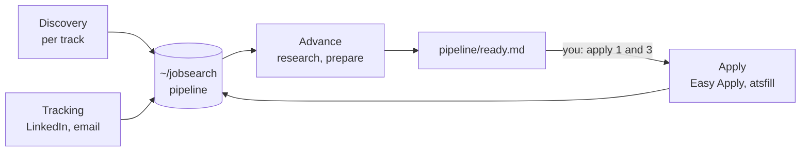

<div align="center">

# hermes-linkedin-jobsearch

A job-search agent for [Hermes](https://hermes-agent.nousresearch.com) that works your LinkedIn pipeline from posting to answer.

[![Version][version-badge]][distribution]
[![Hermes][hermes-badge]][hermes]
[![CI][ci-badge]][ci]
[![License][license-badge]][license]

---

[Install](#install) • [Quickstart](#quickstart) • [How it works](#how-it-works) • [Roadmap](ROADMAP.md)

---

</div>

> [!WARNING]
> 0.x is not stable: skills, workspace layout and settings can change between releases. See the [roadmap](ROADMAP.md) for what is tested.

<!-- Demo placeholder: record a terminal session of `/jobsearch-init` reaching the first track, or a cron report ending with the numbered ready list. -->

hermes-linkedin-jobsearch is a Hermes profile distribution.
It installs an agent that searches LinkedIn on a schedule, researches the companies behind the postings, tailors a resume and answers for each one, and keeps track of every application.
You decide what gets sent.

- Discovery per track: a role family with its own LinkedIn queries, fit scoring and base resume.
- A company dossier for every new entry, then a shortlist or drop with the reason.
- A resume and form answers per application, written from your profile facts, never invented.
- Easy Apply sent once you name the entry. External forms are read and filled through [atsfill](https://github.com/shbernal/atsfill), and sent only if you opt in.
- Status tracking from LinkedIn and, optionally, your email.
- A weekly report on what each track's postings ask for.

## Install

You need [Hermes](https://hermes-agent.nousresearch.com) 0.22.2 or later, a LinkedIn account and [uv](https://docs.astral.sh/uv/).
Setup checks for the other tools (node, git, [cratecv](https://github.com/shbernal/cratecv), optionally [Himalaya](https://github.com/pimalaya/himalaya) for email) and offers to install what is missing.

```bash
hermes profile install github.com/shbernal/hermes-linkedin-jobsearch --alias
```

This creates a `jobsearch` profile and a `jobsearch` command next to your other Hermes profiles.

## Quickstart

1. Pick the model the agent runs on, if the profile has none yet:

   ```bash
   jobsearch model
   ```

2. Open a chat with the agent:

   ```bash
   jobsearch chat
   ```

3. Run the setup and answer its questions:

   ```text
   /jobsearch-init
   ```

Setup logs in to LinkedIn, builds your profile facts from LinkedIn and your CV, interviews you for your criteria, sets what may be sent without asking, creates a first track and schedules the jobs.
It can stop at any step: running it again picks up where it left off.

Tested with `gpt-5.6-sol` through the `openai-codex` provider, and `glm-5.3` through `zai` on the Z.ai coding plan.

## What it never does on its own

| Action | Default | You can change it to |
| --- | --- | --- |
| Submit Easy Apply | after you name the entry ("apply 1 and 3") | prepare only, or send unattended |
| Submit an external form | never: you submit it yourself | after approval, or unattended |
| Hide a job from LinkedIn search for good | never | on |
| Archive email | never | on |
| Message or connect with anyone | never: the tools are disabled | not available |

Sends are capped at 2 a day by default, attended or not.
All of these live in `~/jobsearch/workspace.yaml`.

> [!CAUTION]
> LinkedIn's [user agreement](https://www.linkedin.com/legal/user-agreement) prohibits automated access to the site.
> This agent reads and applies through your own logged-in session, and LinkedIn may restrict or ban an account it flags.
> You use it at your own risk.

## How it works



Everything personal lives in `~/jobsearch`, a git repository the agent commits to: your criteria, profile facts, resumes, company dossiers and the pipeline.
The profile itself holds only the skills and the configuration, so `hermes profile update jobsearch` never touches your data.

Scheduled runs report to the chat you choose during setup (Telegram, Discord, or the local log).
An Advance report ends with the numbered list of ready applications, and you approve by replying to it.

LinkedIn access goes through a pinned [fork of linkedin-mcp-server](https://github.com/shbernal/linkedin-mcp-server) that adds Easy Apply and job close-out tools.

## More

- [Roadmap](ROADMAP.md): what is tested and what comes next
- [Architecture decisions](docs/adr/README.md): workspace, scope, action policy, dependencies
- [Changelog](CHANGELOG.md)

[distribution]: distribution.yaml
[version-badge]: https://img.shields.io/badge/dynamic/yaml?url=https%3A%2F%2Fraw.githubusercontent.com%2Fshbernal%2Fhermes-linkedin-jobsearch%2Fmain%2Fdistribution.yaml&query=%24.version&label=version&style=for-the-badge&color=7aa2f7
[hermes]: https://hermes-agent.nousresearch.com
[hermes-badge]: https://img.shields.io/badge/hermes-%E2%89%A50.22.2-bb9af7?style=for-the-badge
[ci]: https://github.com/shbernal/hermes-linkedin-jobsearch/actions/workflows/install.yml
[ci-badge]: https://img.shields.io/github/actions/workflow/status/shbernal/hermes-linkedin-jobsearch/install.yml?branch=main&label=install&style=for-the-badge&color=9ece6a
[license]: LICENSE
[license-badge]: https://img.shields.io/github/license/shbernal/hermes-linkedin-jobsearch?style=for-the-badge&color=e0af68
